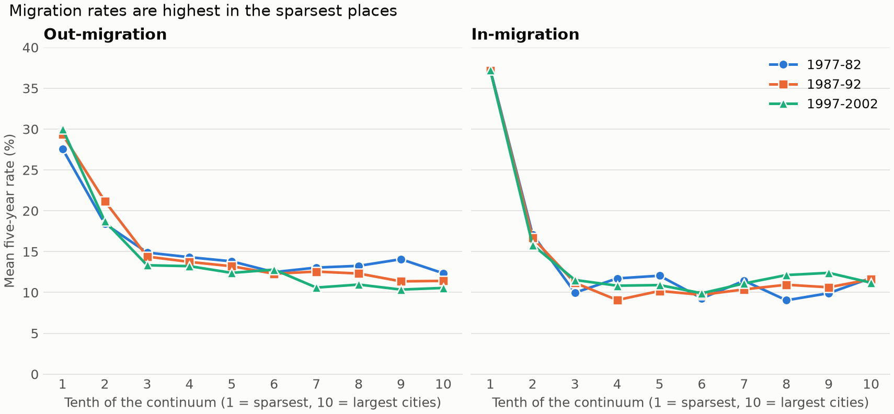

# Internal Migration Along Chile's Rural–Urban Continuum (1982–2002)

How do internal migration patterns vary along Chile's rural–urban continuum across three census
periods, and how sensitive are the observed patterns to historical municipal boundary changes?

A settlement-level analysis of census migration flows between 304 municipalities. It is a partial conceptual
replication, for one country, of Lerch, Du & Beckendorff (2026),
[*The Spatial Diffusion of Internal Migration Across the Rural-Urban Continuum in Developing Countries*](https://doi.org/10.1007/s10680-026-09774-w),
with a different data source and an added check on boundary changes made in 1979.

**[Read the report](reports/report.md)** (tables: [reports/tables.md](reports/tables.md))



## Findings

- Both out- and in-migration rates were lower toward the urban end of the continuum in all three periods.
- The pattern is not linear: rates are far higher in the sparsest places and vary much less across the rest.
- Grouping municipalities affected by suspected 1979 boundary artefacts changed the slopes by about one percentage point at most.
  The grouping is an approximation, **not** a reconstruction of historical boundaries.

Results are descriptive. Spatial dependence between neighbours and formal tests of change over time are outside the scope.

## Method in brief

1. Group municipalities into 30 cities (GHSL Functional Urban Areas) and 206 ranked rural settlements.
2. Rank them: rural by density, then cities by population.
3. Calculate five-year out- and in-migration rates from origin–destination matrices.
4. Fit a straight line per outcome and census period (OLS, HC3 standard errors).
5. Repeat with municipalities affected by the 1979 changes grouped together.

## Run it

Python 3.11. Everything needs the raw data, which is **not** in this repository.

```sh
python3.11 -m venv .venv
source .venv/bin/activate
pip install -r requirements.txt
python src/acquire.py        # about 0.9 GB; checks sizes and SHA-256
python spatial_diffusion.py  # rates, regressions, tables, figures
python -m pytest             # tests that need raw data are skipped without it
```

If the CHIM download is unavailable, download the archive by hand from the address in
[docs/data_sources.md](docs/data_sources.md) and run `python src/acquire.py --from-file chim PATH`.

## Data and licences

| Dataset | Used for | Terms |
|---|---|---|
| [CHIM](https://geodacenter.github.io/data-and-lab/CHIM/) (Rowe 2017) | Flows, boundaries | No licence found; offered "as is" |
| [GHS-FUA, GHS-POP, GHS-SMOD R2019A](https://human-settlement.emergency.copernicus.eu/) | Cities, population overlap | CC BY 4.0, © European Union |

Because CHIM's terms are unclear, its data, the flow matrices and values for individual settlements are not
published here. Only aggregate results are. See [docs/data_sources.md](docs/data_sources.md).

## Layout

```
spatial_diffusion.py  runs the analysis
src/                  acquire, chim, boundaries, geography, measures, samples, models, figures
tests/                automated checks
docs/                 data sources, definitions, decisions
reports/              report, tables, figures
data/                 raw and processed data (not committed)
```
