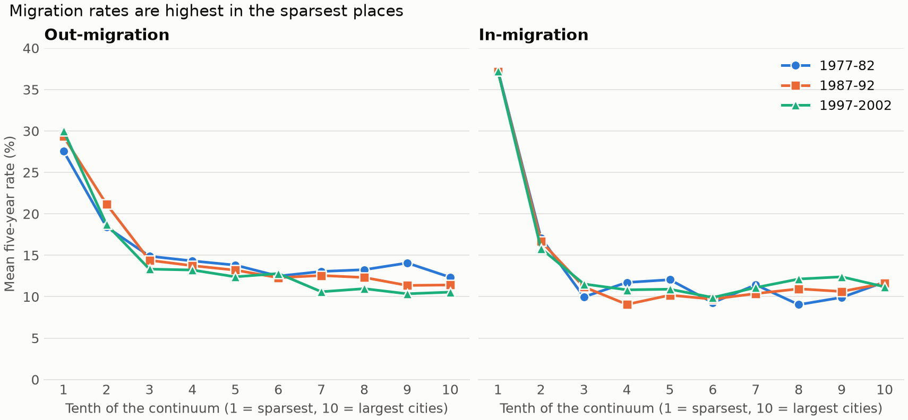
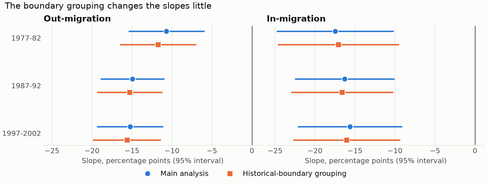

# Internal Migration Along Chile's Rural–Urban Continuum, 1982–2002

A settlement-level analysis built from municipal census data.

## Question

How do internal migration patterns vary along Chile's rural–urban continuum across three census
periods (1977–82, 1987–92, 1997–2002), and how sensitive are the observed patterns to historical
municipal boundary changes?

This is a partial conceptual replication, for one country, of the first step in Lerch, Du & Beckendorff (2026),
[*The Spatial Diffusion of Internal Migration Across the Rural-Urban Continuum in Developing
Countries*](https://doi.org/10.1007/s10680-026-09774-w). It uses a different data source and adds a
sensitivity check for municipal boundary changes made in 1979.

## Data and method

- **Migration:** origin–destination counts between 304 harmonized municipalities from CHIM (Rowe 2017),
  comparing residence at the census with residence five years earlier, for people aged 5+.
- **Settlements:** municipalities with at least half their people in a Functional Urban Area (GHS-FUA) are grouped into
  30 cities; 206 others are rural settlements. All 236 are ranked. Two Pacific islands stay in the flows
  but are not ranked; Antártica is excluded.
- **Position:** rural settlements ordered by density, then cities by population, divided by the number ranked.
  It runs from just above 0 (sparsest) to 1 (largest city).
- **Rates (five-year):** out-migration = departures / population at origin; in-migration = arrivals / average of the population at
  the start and end.
- **Model:** for each outcome and period, rate = b0 + b1 × position, by ordinary least squares with every settlement weighted
  equally and heteroskedasticity-robust (HC3) standard errors. 
  The slope estimates the change in the fitted migration rate across a one-unit change in normalized settlement position, expressed in percentage points.
  Observed positions run from 1/n to 1, so one unit is almost exactly the whole continuum.

Definitions: [docs/measures.md](../docs/measures.md), [docs/geography.md](../docs/geography.md).
All results: [tables.md](tables.md).

## Main results

| Slope, percentage points (95% interval) | 1977–82 | 1987–92 | 1997–2002 |
|---|---|---|---|
| Out-migration | −10.7 (−15.4, −5.9) | −14.9 (−18.9, −10.9) | −15.2 (−19.4, −11.1) |
| In-migration | −17.5 (−24.8, −10.2) | −16.3 (−22.5, −10.1) | −15.6 (−22.2, −9.1) |

1. **Both rates are lower toward the urban end in every period.**
2. **The pattern is not a straight line.** Rates are very high in the sparsest tenth of settlements (28–30% out, 37% in), fall steeply over the
   next two tenths, and vary much less across the rest. The slope alone is a poor summary.
3. **Differences between periods are descriptive.** The out-migration slope is steeper in the last two periods than in 1977–82, and the
   in-migration slope slightly flatter in each, but the intervals overlap and no formal test of change was made.

### Exploratory check: not a main result

This only shows how far the fitted line depends on the sparsest places; it is not a second estimate of the gradient. Without the sparsest tenth, out-migration slopes are −4.8, −8.8 and −8.0 and in-migration slopes −4.8, −3.0 and −2.4.
Still negative, but much smaller. This cutoff was chosen after seeing the averages by tenth.

### Sample check

This fit leaves out Florida and San Pedro, whose 1997–2002 flows may include confusion with similarly
named places (unconfirmed). Slopes change by about 0.1 points or less.

## Sensitivity to the 1979 boundary changes

This section is separate from the main results, which are unchanged by it.

**Why.** Decreto Ley 2868 of 1979 moved territory between municipalities within the 1977–82 interval. People living in
transferred territory may have reported the former municipality as their earlier residence without moving. That would look like
migration. This way of answering is inferred, not observed.

**What was done.** Eight unusually large one-way flows were noticed in 1977–82. The decree records a
transfer matching seven; the eighth (Quinchao to Dalcahue) is indirect, through Quemchi, which CHIM includes in its Dalcahue unit. The
municipalities involved were combined into five groups in all three periods, and everything was recalculated with 228 ranked settlements.

**This is an approximation, not a reconstruction of 1977 boundaries.** Whole municipalities are grouped although only
parts moved; genuine moves inside the groups disappear too; larger units have lower rates mechanically; other transfers
in the decree are not covered. The decree text read is a later consolidated version. See
[docs/historical_boundaries.md](../docs/historical_boundaries.md).

| Slope, percentage points | 1977–82 | 1987–92 | 1997–2002 |
|---|---|---|---|
| Out: main / grouped | −10.7 / −11.7 | −14.9 / −15.3 | −15.2 / −15.6 |
| In: main / grouped | −17.5 / −17.1 | −16.3 / −16.6 | −15.6 / −16.0 |

The comparison evaluates the sensitivity of the results to this particular grouping procedure; it does not isolate the causal effect of the
1979 reforms. It also changes the analytical sample (236 to 228 units) and mechanically combines populations.

- **The slopes are not very sensitive to this grouping.** The largest change is about one point (out-migration, 1977–82), small
  beside the intervals. The shape of the curve is the same.
- **Some local averages move.** In 1977–82, in-migration in the fourth tenth falls from 11.7% to 9.2%, and out-migration in the ninth from
  14.1% to 12.4%.
- Grouped slopes differ slightly in 1987–92 and 1997–2002 too, when the 1979 transfers should matter less, so the differences
  partly reflect grouping itself, not only the boundary changes.

## Limits

- Descriptive association, not causation.
- 206 of 236 units are rural, so the slope mainly describes density differences among rural places.
- The sparsest units are small, and some include military, mining or farm workers, so rates there are volatile.
- Dependence between neighbouring settlements is not modelled, so intervals may be too narrow.
- Cities are defined with 2015 data.
- Population enters both the rates and the ranking, so some correlation is built in.
- CHIM omits moves within the interval and people absent at either date.
- **Not comparable one-to-one with the paper.** Its slopes for Chile, read from its Figure 3, are around −3 to −4 points for out-migration. Ours
  point the same way but are steeper. Data, units and outlier treatment differ (the paper removes outliers); the reason for the gap was not established.

## Conclusion

In Chile, five-year migration rates were far higher in the sparsest settlements and varied much less across the rest of the
continuum, in all three periods. Grouping municipalities affected by eight suspected 1979 boundary artefacts changed some local averages but left
this pattern largely intact.

## Sources

- Lerch, Du & Beckendorff (2026), https://doi.org/10.1007/s10680-026-09774-w
- Rowe, F. (2017). The CHilean Internal Migration (CHIM) database. *REGION* 4(3), R1–R6. https://doi.org/10.18335/region.v4i3.198
- European Commission, JRC: GHS-FUA, GHS-POP and GHS-SMOD, R2019A, © European Union, CC BY 4.0; overlaid with municipal boundaries and aggregated here.
- Decreto Ley 2868 (1979), https://www.bcn.cl/leychile/Navegar?idNorma=7020
